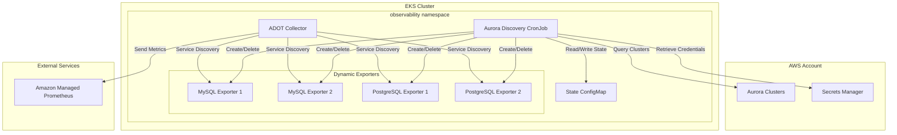

# Aurora Auto-Discovery Design Document

## Overview

The Aurora Auto-Discovery system extends the existing EKS-based database monitoring infrastructure to automatically discover and monitor Amazon Aurora clusters. The system consists of a Kubernetes CronJob that periodically scans for Aurora clusters, retrieves their credentials from AWS Secrets Manager, and dynamically manages Prometheus exporter deployments. The existing ADOT Collector is enhanced with Kubernetes Service Discovery to automatically collect metrics from dynamically created exporters.

## Architecture

### High-Level Architecture



### Component Interaction Flow

1. **Discovery Phase**: CronJob queries RDS API for Aurora clusters
2. **State Comparison**: Compare current clusters with stored state in ConfigMap
3. **Credential Retrieval**: Fetch database credentials from Secrets Manager
4. **Resource Management**: Create/update/delete exporter resources as needed
5. **State Update**: Update ConfigMap with current cluster state
6. **Metric Collection**: ADOT Collector discovers and scrapes exporters via Service Discovery

## Components and Interfaces

### 1. Aurora Discovery CronJob

**Purpose**: Main orchestrator that handles cluster discovery and exporter lifecycle management.

**Container Image**: Custom Python-based image with AWS SDK and Kubernetes client
**Schedule**: `0 * * * *` (every hour)
**Resource Requirements**:
- CPU: 200m request, 500m limit
- Memory: 256Mi request, 512Mi limit

**Key Interfaces**:
- AWS RDS API: `describe_db_clusters()` for cluster discovery
- AWS Secrets Manager API: `get_secret_value()` for credential retrieval
- Kubernetes API: CRUD operations on Deployments, Services, Secrets, ConfigMaps

**Environment Variables**:
- `AWS_REGION`: Target AWS region
- `NAMESPACE`: Kubernetes namespace (default: observability)
- `STATE_CONFIGMAP_NAME`: Name of state tracking ConfigMap
- `LOG_LEVEL`: Logging verbosity (default: INFO)

### 2. State Management ConfigMap

**Purpose**: Persistent storage for tracking managed Aurora clusters without external dependencies.

**Structure**:
```yaml
apiVersion: v1
kind: ConfigMap
metadata:
  name: aurora-discovery-state
  namespace: observability
data:
  clusters.json: |
    {
      "last_updated": "2024-01-15T10:30:00Z",
      "clusters": {
        "aurora-mysql-cluster-1": {
          "engine": "aurora-mysql",
          "endpoint": "cluster-1.cluster-xyz.us-east-1.rds.amazonaws.com",
          "port": 3306,
          "secrets_arn": "arn:aws:secretsmanager:us-east-1:123456789012:secret:aurora-mysql-cluster-1-AbCdEf",
          "status": "available"
        }
      }
    }
```

### 3. Dynamic Exporter Resources

**MySQL Exporter Template**:
- **Deployment**: `aurora-mysql-{cluster-identifier}`
- **Service**: `aurora-mysql-{cluster-identifier}` with Service Discovery labels
- **Secret**: `aurora-mysql-{cluster-identifier}-credentials`

**PostgreSQL Exporter Template**:
- **Deployment**: `aurora-postgresql-{cluster-identifier}`
- **Service**: `aurora-postgresql-{cluster-identifier}` with Service Discovery labels  
- **Secret**: `aurora-postgresql-{cluster-identifier}-credentials`

**Service Discovery Labels**:
```yaml
metadata:
  labels:
    app.kubernetes.io/name: aurora-exporter
    app.kubernetes.io/component: mysql-exporter  # or postgresql-exporter
    aurora.aws/cluster-identifier: cluster-name
    aurora.aws/engine: aurora-mysql  # or aurora-postgresql
  annotations:
    prometheus.io/scrape: "true"
    prometheus.io/port: "9104"  # or 9187 for PostgreSQL
    prometheus.io/path: "/metrics"
```

### 4. Enhanced ADOT Collector Configuration

**Service Discovery Configuration**:
```yaml
scrape_configs:
- job_name: aurora-mysql-exporters
  kubernetes_sd_configs:
  - role: service
    namespaces:
      names: [observability]
  relabel_configs:
  - source_labels: [__meta_kubernetes_service_label_app_kubernetes_io_name]
    action: keep
    regex: aurora-exporter
  - source_labels: [__meta_kubernetes_service_label_app_kubernetes_io_component]
    action: keep
    regex: mysql-exporter
  - source_labels: [__meta_kubernetes_service_annotation_prometheus_io_scrape]
    action: keep
    regex: true
  - source_labels: [__meta_kubernetes_service_annotation_prometheus_io_path]
    action: replace
    target_label: __metrics_path__
    regex: (.+)
  - source_labels: [__address__, __meta_kubernetes_service_annotation_prometheus_io_port]
    action: replace
    regex: ([^:]+)(?::\d+)?;(\d+)
    replacement: $1:$2
    target_label: __address__

- job_name: aurora-postgresql-exporters
  kubernetes_sd_configs:
  - role: service
    namespaces:
      names: [observability]
  relabel_configs:
  - source_labels: [__meta_kubernetes_service_label_app_kubernetes_io_name]
    action: keep
    regex: aurora-exporter
  - source_labels: [__meta_kubernetes_service_label_app_kubernetes_io_component]
    action: keep
    regex: postgresql-exporter
  # ... similar relabel configs
```

## Data Models

### Cluster State Model

```python
@dataclass
class AuroraCluster:
    identifier: str
    engine: str  # 'aurora-mysql' or 'aurora-postgresql'
    endpoint: str
    port: int
    secrets_arn: str
    status: str
    last_seen: datetime
    
@dataclass
class ClusterState:
    last_updated: datetime
    clusters: Dict[str, AuroraCluster]
```

### Kubernetes Resource Templates

**Exporter Deployment Template**:
```python
def create_exporter_deployment(cluster: AuroraCluster, image: str, port: int) -> V1Deployment:
    return V1Deployment(
        metadata=V1ObjectMeta(
            name=f"aurora-{cluster.engine.replace('aurora-', '')}-{cluster.identifier}",
            namespace="observability",
            labels={
                "app.kubernetes.io/name": "aurora-exporter",
                "app.kubernetes.io/component": f"{cluster.engine.replace('aurora-', '')}-exporter",
                "aurora.aws/cluster-identifier": cluster.identifier,
                "aurora.aws/engine": cluster.engine
            }
        ),
        spec=V1DeploymentSpec(
            replicas=1,
            selector=V1LabelSelector(match_labels={"app": f"aurora-{cluster.identifier}"}),
            template=V1PodTemplateSpec(
                metadata=V1ObjectMeta(labels={"app": f"aurora-{cluster.identifier}"}),
                spec=V1PodSpec(
                    containers=[
                        V1Container(
                            name="exporter",
                            image=image,
                            ports=[V1ContainerPort(container_port=port)],
                            env=[
                                V1EnvVar(
                                    name="DATA_SOURCE_NAME",
                                    value_from=V1EnvVarSource(
                                        secret_key_ref=V1SecretKeySelector(
                                            name=f"aurora-{cluster.identifier}-credentials",
                                            key="data-source-name"
                                        )
                                    )
                                )
                            ]
                        )
                    ]
                )
            )
        )
    )
```

## Error Handling

### AWS API Error Handling

1. **Rate Limiting**: Implement exponential backoff for AWS API calls
2. **Permission Errors**: Log specific IAM permission requirements and continue
3. **Network Errors**: Retry with circuit breaker pattern
4. **Invalid Secrets**: Skip cluster and log warning for manual intervention

### Kubernetes API Error Handling

1. **Resource Conflicts**: Use server-side apply for idempotent operations
2. **RBAC Errors**: Log specific permission requirements and fail gracefully
3. **Resource Quotas**: Log quota exceeded errors and continue with other clusters
4. **Network Errors**: Retry with exponential backoff

### State Management Error Handling

1. **ConfigMap Corruption**: Recreate from current AWS state
2. **Concurrent Modifications**: Use resource version for optimistic locking
3. **Missing ConfigMap**: Create new one with current cluster state

## Testing Strategy

### Unit Testing

1. **AWS Client Mocking**: Mock boto3 clients for RDS and Secrets Manager
2. **Kubernetes Client Mocking**: Mock kubernetes client for resource operations
3. **State Management**: Test ConfigMap serialization/deserialization
4. **Error Scenarios**: Test all error handling paths

### Integration Testing

1. **LocalStack**: Use LocalStack for AWS service simulation
2. **Kind Cluster**: Test against local Kubernetes cluster
3. **End-to-End**: Full workflow from cluster discovery to metric collection

### Performance Testing

1. **Scale Testing**: Test with 50+ Aurora clusters
2. **Memory Usage**: Monitor memory consumption during large cluster discovery
3. **Execution Time**: Ensure CronJob completes within 30-minute window

## Security Considerations

### IAM Permissions

**Required AWS Permissions**:
```json
{
    "Version": "2012-10-17",
    "Statement": [
        {
            "Effect": "Allow",
            "Action": [
                "rds:DescribeDBClusters",
                "rds:ListTagsForResource"
            ],
            "Resource": "*"
        },
        {
            "Effect": "Allow",
            "Action": [
                "secretsmanager:GetSecretValue"
            ],
            "Resource": "arn:aws:secretsmanager:*:*:secret:*"
        }
    ]
}
```

**Required Kubernetes RBAC**:
```yaml
apiVersion: rbac.authorization.k8s.io/v1
kind: ClusterRole
metadata:
  name: aurora-discovery
rules:
- apiGroups: [""]
  resources: ["secrets", "configmaps", "services"]
  verbs: ["get", "list", "create", "update", "patch", "delete"]
- apiGroups: ["apps"]
  resources: ["deployments"]
  verbs: ["get", "list", "create", "update", "patch", "delete"]
```

### Secret Management

1. **Credential Isolation**: Each cluster gets its own Kubernetes Secret
2. **Secret Rotation**: Support automatic credential updates from Secrets Manager
3. **Least Privilege**: Exporters only access their specific database credentials

## Deployment Strategy

### Helm Chart Integration

The Aurora Discovery system will be integrated into the existing `db-monitoring` Helm chart as a new component:

```yaml
# values.yaml addition
aurora-discovery:
  enabled: true
  schedule: "0 * * * *"  # Every hour
  image:
    repository: aurora-discovery
    tag: "1.0.0"
  resources:
    requests:
      cpu: 200m
      memory: 256Mi
    limits:
      cpu: 500m
      memory: 512Mi
  aws:
    region: us-east-1
  serviceAccount:
    create: true
    annotations:
      eks.amazonaws.com/role-arn: ""
```

### Migration Strategy

1. **Phase 1**: Deploy Aurora Discovery CronJob alongside existing static exporters
2. **Phase 2**: Update ADOT Collector configuration to use Service Discovery
3. **Phase 3**: Gradually remove static exporter configurations
4. **Phase 4**: Full cutover to dynamic discovery system

## Monitoring and Observability

### Metrics

The Aurora Discovery system will expose its own metrics:

- `aurora_discovery_clusters_total`: Total number of discovered clusters
- `aurora_discovery_exporters_created_total`: Number of exporters created
- `aurora_discovery_exporters_deleted_total`: Number of exporters deleted
- `aurora_discovery_errors_total`: Number of errors by type
- `aurora_discovery_execution_duration_seconds`: CronJob execution time

### Logging

Structured logging with the following levels:
- **INFO**: Cluster discovery, resource creation/deletion
- **WARN**: Skipped clusters, credential issues
- **ERROR**: AWS API failures, Kubernetes API failures
- **DEBUG**: Detailed operation traces

### Alerting

Key alerts to implement:
- CronJob execution failures
- High error rates in cluster discovery
- Exporter deployment failures
- ConfigMap corruption or loss